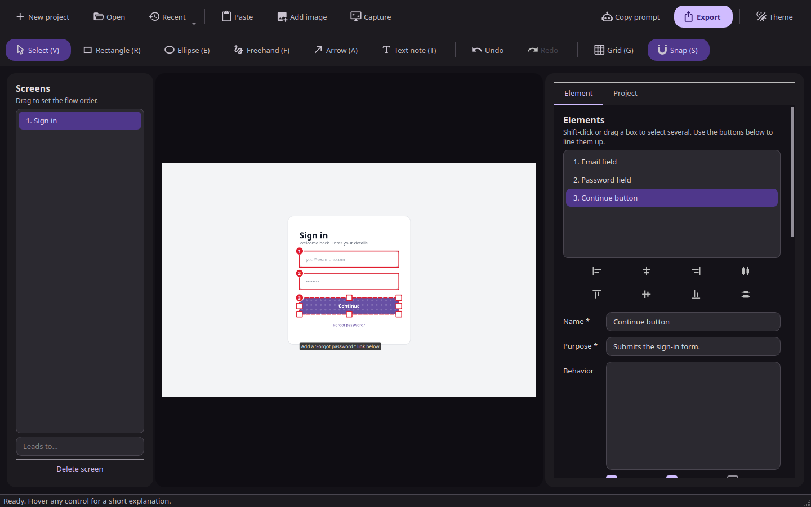

# uispec

**Annotate UI screenshots and hand the spec to your coding agent.**

uispec is a desktop editor for describing how a user interface should look and behave. Draw numbered
elements over a screenshot of any app, describe each one in depth, and export a spec bundle that
an agent can read and implement.



## Features

- **Screenshots in any way you like:** paste from the clipboard, drop image files, add files, or capture a region of your screen (Wayland-safe, via the desktop portal).
- **Numbered elements:** draw rectangles, ellipses, or freehand outlines. Each one gets a pin that the description refers to.
- **Resize and move:** drag the handles on a selected element to resize it, drag its pin to resize from the top-left, or drag the body to move it. Agents can resize with `uispec element resize`.
- **Structured descriptions:** name, purpose, behavior, states (checklist plus custom), content, constraints, notes, and a reference link.
- **Flows:** order screens by drag and drop, add a "leads to" note, and draw arrows between elements.
- **Project brief and design tokens:** purpose, audience, tone, colors, fonts, spacing, and radii apply to every screen.
- **Spec bundles:** each export writes `spec.md`, annotated and original PNGs, and per-element JSON to a timestamped folder. `current/` always points at the latest.
- **Agent control:** a `uispec` command drives the running app over a token-guarded localhost API, so an agent can add, edit, and export elements while you watch.
- **Undo and redo** for every change, including the ones made by agents.
- **Material Design UI:** dark and light themes, icon toolbars, and a tooltip on every control.

## Install

Requires Python 3.10+ and a desktop session (Linux tested; Qt should run on macOS and Windows, but only Linux is verified).

```bash
git clone https://github.com/Klannato/uispec.git
cd uispec
python3 -m venv venv
./venv/bin/pip install -e '.[test]'
ln -sfn "$PWD/venv/bin/uispec" ~/.local/bin/uispec
uispec skill install          # installs the ui-spec agent skill
```

## Quick start

```bash
uispec project new --name myapp            # creates ~/ui-specs/myapp and opens the app
uispec screen add login.png --name Login
uispec element add --box 40,40,200,60      # x,y,w,h in image pixels
uispec element edit 1 --set name=Submit --set purpose="Logs the user in" --set states="default,hover,disabled"
uispec arrow add --from 1 --to 2 --label "on success"
uispec export                              # writes ~/ui-specs/myapp/current/spec.md
```

Run `uispec --help` for every command. Add `--json` for machine-readable output.

## How agents use it

The bundled `ui-spec` skill tells a coding agent to read `current/spec.md` and the annotated images
before building a UI, implement each numbered element against its fields, render the result, and
report any mismatch rather than silently diverging. Copy the prompt from the app's toolbar to hand
off a task.

## Project layout

```
src/uispec/
  model.py       data model: projects, screens, elements, arrows, labels
  controller.py  owns the open project; undo/redo; autosave
  commands.py    command handlers shared by the GUI, CLI, and API
  api.py         localhost JSON API with a per-run token
  cli.py         the `uispec` command
  exporter.py    spec.md, annotated PNGs, element JSON
  render.py      drawing for the canvas and exports
  capture.py     screenshot portal for region capture
  gui/           Qt (PySide6) window, canvas, panels, Material theme
  skill/         the ui-spec agent skill
tests/           unit and command-level tests
```

## Development

```bash
./venv/bin/pip install -e '.[test]'
./venv/bin/pytest
```

See [CONTRIBUTING.md](CONTRIBUTING.md) for guidelines.

## License

[MIT](LICENSE)
